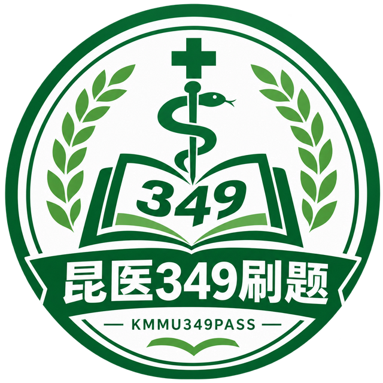

  

# 昆医 349 药学综合刷题系统

面向**昆明医科大学 349 药学综合自命题**备考，覆盖**药理学、药物化学、药剂学、药物分析**。同一套 HTML、CSS 和 JavaScript 界面可在 Windows 独立窗口、电脑浏览器和手机上使用。

## 功能

- **章节练习**　精选题库和强化题库支持按科目、教材章节、考点和题型筛选，可搜索题干、断点续做。
- **真题与模拟**　按年份训练真题，或从题库随机抽题限时模拟。分别统计客观题、主观题正确率和用时。
- **答案与解析**　查看题源、解题分析、逐项说明和关联知识。主观题支持按采分点给出关键词匹配反馈。
- **知识导航**　按药名、别名和教材术语搜索词条，查看药理作用、用途与关联药物。
- **复习记录**　收藏题目和词条、整理错题、写笔记，查看学习天数与考研倒计时。设置中可备份和导入个人数据，错题与收藏可导出 Markdown 或纯文本。

## 下载与启动

从 [Releases](https://github.com/Aniyasama-hub/kmmu349pass/releases) 下载桌面与手机合集或题库元信息。在 Windows x64 安装 **Python 3.10+**（加入 PATH）和 [Microsoft Edge WebView2 Runtime](https://developer.microsoft.com/microsoft-edge/webview2/)。解压后双击 **Windows桌面版**里的 **启动题库.cmd**。

电脑也能直接打开 **练习前端/index.html**。在项目目录执行 **python -X utf8 local_study.py** 可启动本机服务并将学习记录写入磁盘。

手机版目录可作为静态站点部署，入口为 **index.html**。通过 HTTPS 打开后，可在 Android Chrome 安装，或在 iPhone Safari 添加到主屏幕。首次联网打开，设置中出现「离线题库可用」后可断网练习。 [手机版构建与安装](mobile/README.md)

## 题库与结构

题目、知识词条和题图可随应用使用，也可以导入自己整理的结构化资料。源码自带演示数据，完整题库随应用包提供。

| 目录或文件 | 用途 |
| --- | --- |
| 练习前端/ | 共用界面、答题流程、评分与知识导航 |
| windows/、启动题库.cmd | Windows 独立窗口和启动器 |
| local_study.py | Python 标准库实现的本机服务和学习档案 |
| mobile/、tools/build_mobile.py | 手机安装与离线资源、静态站点构建 |
| examples/、tools/prepare_bank.py | 结构化数据示例和题库导入 |

使用自己的题库时，参考[题目示例](examples/题目元信息.json)和[词条示例](examples/知识词条.json)，再运行下列命令。

~~~powershell
python -X utf8 tools/prepare_bank.py "D:/我的资料/题目元信息.json" --terms "D:/我的资料/知识词条.json"
~~~

导入结果在 **.local/昆医349/**，可通过 **--output** 另选目录。词条可省略，题图放在资料旁的 **题图/** 或 **练习前端/题图/**，也可以用 **--assets** 指定位置。真题按元信息中的年份和题号组织。

Windows 桌面端的学习记录保存在 **%LOCALAPPDATA%/Kunming349/Profile/profile.json**，浏览器和手机端使用各自的本地存储。可在各设备上用设置中的「备份个人数据」和「导入备份」迁移。
